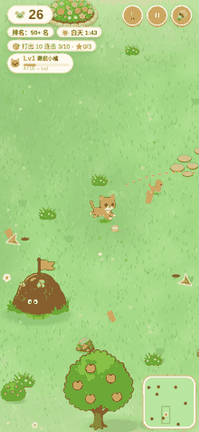
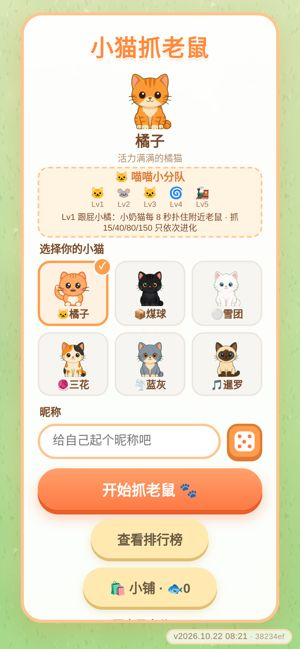
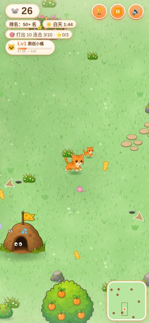
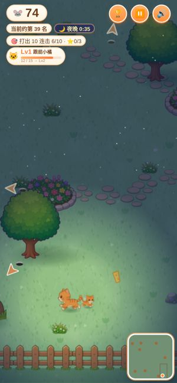

# 🐱 小猫抓老鼠 Cat Mouse Chase

> 俯视角休闲小游戏：操控小猫在花园里追老鼠、端老鼠窝、冲排行榜。手机和电脑都能玩。
> *A cozy top-down cat-chases-mice browser game.*

## ▶️ [立即开玩 → meow.12121313.xyz](https://meow.12121313.xyz/)

备用地址：<https://ora-ora.github.io/cat-jump/>

<p align="center">
  
  
  
  
</p>

## 玩法

- **操作**：手机按住屏幕往哪边拖，小猫就往哪边跑；电脑用方向键或 WASD。右上角可以暂停、静音、看排行榜。
- **自动扑抓**：靠近老鼠会自动扑上去抓住。连续抓到会累积连击，连击越高横幅越夸张。
- **老鼠窝与便便**：地图上分布着老鼠窝，会不断冒出老鼠，猫靠近时会停止出鼠。开局 20 秒后，站到窝上不动 3 秒就能拉一坨便便把窝摧毁，得 30 分。被毁的窝过一段时间会重新长出来。
- **昼夜**：一个循环是白天 120 秒，黄昏 8 秒，夜晚 60 秒，黎明 8 秒。夜里老鼠出得更快，还有萤火虫。
- **每局任务**：开局随机抽 3 个小任务，比如抓多少只老鼠、打出多少连击、摧毁老鼠窝、坚持到夜晚。完成一个得一颗星，不影响分数。
- **小鱼干与帽子小铺**：每局结束按得分和完成的星星数发小鱼干，可以在开始页的「小铺」买帽子给猫戴上。小鱼干只存在本机。
- **排行榜**：在线实时排行，能看到谁正在玩、当前多少分，也能按猫筛选。

## 6 只猫与技能

每只猫有一条会进化的专属技能，随着本局抓到的老鼠数逐级升级，共 5 级：

| 猫 | 技能 | 第 1 级 → 第 5 级 |
|---|---|---|
| 🧡 橘子 | 喵喵小分队 | 跟屁小橘（小奶猫帮你扑鼠）→ 猫猫列车 |
| 🖤 煤球 | 魔术纸箱 | 神秘纸箱（老鼠钻箱，撞箱全吃）→ 黑猫魔术秀 |
| 🤍 雪团 | 滚滚雪球 | 小雪球（冻住老鼠）→ 暴风雪舞 |
| 🧶 三花 | 魔法毛线 | 套索（把老鼠拉近）→ 翻花绳 |
| 🩶 蓝灰 | 圆滚滚旋风 | 小旋风（直线跑出旋风吸晕老鼠）→ 大胖龙卷 |
| 🎵 暹罗 | 歌剧喵 | 高音符（让老鼠跳舞）→ 老鼠合唱团 |

## 特性

- 所有角色、老鼠、老鼠窝、树、花坛、石板路都是手绘风精灵（`web/img/*.webp`）。每只猫的正面、侧面、背面都有 8 帧跑步动画和飞扑帧。
- 地图有边界栅栏，树、花坛、石板路等装饰按区块随机生成，不会挡住老鼠窝和出生点。
- 有打击停顿、冲击特效、连击横幅、镜头前瞻、昼夜光照、萤火虫等手感细节。
- 音效全部用 WebAudio 实时合成，没有音频文件。
- 自动适配性能：会实时监测帧率，在弱设备上自动降低分辨率，并关掉模糊、萤火虫等开销大的效果。
- 页面会显示当前构建版本（`version.js`，部署时注入）。

## 技术架构

```
浏览器 (Canvas 2D, 原生 JS, 无构建)
   │  HTTPS
   ▼
Cloudflare Pages ── meow.12121313.xyz（静态资源）
   │  API 请求
   ▼
Cloudflare Worker ── api.12121313.xyz（worker/src.js）
   │  限流 + 用 PROXY_SECRET 签名转发真实客户端 IP
   ▼
Supabase (Postgres + RPC)
```

- **前端**：在 `web/` 下，纯 HTML/CSS/JS 加 Canvas 2D，不依赖任何框架或 CDN。`game.js` 是主循环和玩法，`anim.js` 是程序化动画后备，`art.js` 是皮肤配色和头像，`audio.js` 是合成音效。
- **代理**：Cloudflare Worker，有按 IP 的限流（Rate Limiting binding `RL`），并给请求加上签名过的客户端 IP。数据库端用 `proxy_signed_ok()` 校验签名。
- **后端**：Supabase。游戏通过 RPC `start_run` / `heartbeat` / `finish_run` 上报，排行榜用 `leaderboard_live` 视图和 `leaderboard_best` 表。
- **防作弊（服务端）**：
  - 每秒得分上限、每次抓鼠的最低和最高得分、最短抓鼠间隔。
  - 按皮肤、技能等级、通用技能、夜晚分别计算倍率上限。
  - 心跳校验。
  - 昵称敏感词过滤。
- **CI/CD（GitHub Actions）**：
  - 推送到 `main` 后，同时部署 GitHub Pages 和 Cloudflare Pages，并注入构建版本。
  - Supabase 迁移会先做 lint 和远程 dry-run 检查，再自动 `db push`。
  - 有定时只读查询，让 Supabase 项目保持活跃。

## 本地运行

```bash
cd web
python3 -m http.server 8000
# 浏览器打开 http://localhost:8000
```

不需要构建。后端连不上时游戏照样能玩，只是排行榜不可用。

## 部署

推送到 `main` 就会自动部署。需要在 GitHub 仓库的 Secrets 里配置下面这些（只写名字，**值千万不要提交到仓库**）：

| Secret | 用途 |
|---|---|
| `CLOUDFLARE_API_TOKEN` / `CLOUDFLARE_ACCOUNT_ID` | 部署 Cloudflare Pages |
| `SUPABASE_ACCESS_TOKEN` / `SUPABASE_PROJECT_ID` / `SUPABASE_DB_PASSWORD` | 执行 Supabase 迁移 |
| `CAT_PROXY_SECRET` | 代理签名密钥，同步到数据库端 |

Worker 用 `wrangler deploy` 发布（配置见 `worker/wrangler.toml`），它的签名密钥通过 `wrangler secret put PROXY_SECRET` 设置。完整步骤见 [`SETUP.md`](./SETUP.md)。

## 目录结构

```
web/                 游戏本体（Pages 只发布这个目录）
  index.html  style.css  game.js  anim.js  art.js  audio.js  version.js
  img/               手绘精灵（webp）
worker/              Cloudflare Worker API 代理（src.js, wrangler.toml）
supabase/            数据库迁移（表、视图、RPC、防作弊常量、定时任务）
.github/workflows/   Pages 部署、Supabase 迁移检查/部署、保活
docs/                README 用的截图和 GIF
SETUP.md             站长配置步骤
```
